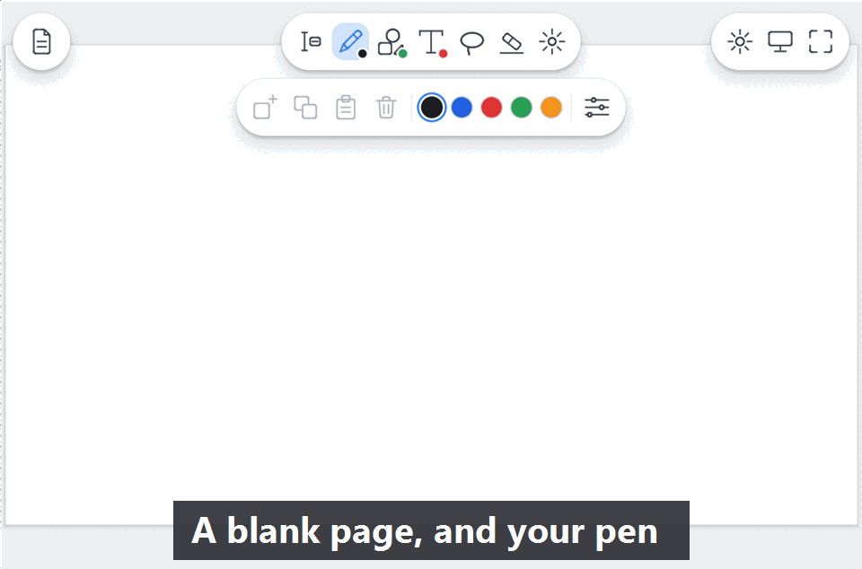
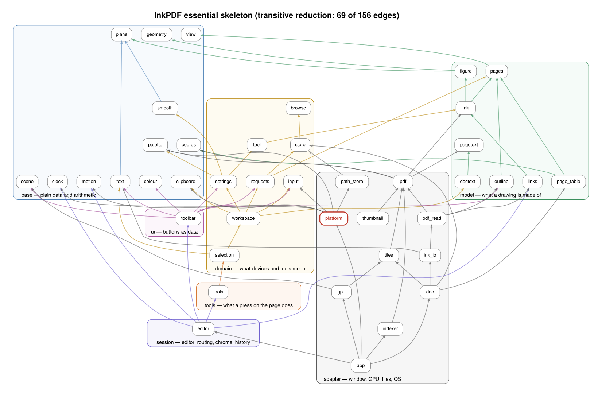

# InkPDF

A fast, pen-first PDF annotator for Windows, Linux and Android. Open a PDF, write on it with a stylus, save it back. No account, no
library, no sync: just the page and your pen.



## Features

- **Ink that keeps up with the pen.** The pen is read as late as possible; the stroke follows the tip (about 2.5 ms from pen sample to frame).
- **Tools:** pen, shapes (lines, polylines, splines, rectangles, ellipses, axes), typed text, lasso, eraser, sticky notes with reply threads, and a select tool for reading.
- **Real PDF annotations.** Ink and shapes are saved as standard Ink annotations, typed text as Free Text, marks as highlight, underline and
  strike-out. Any PDF reader shows them. Nothing is uploaded.
- **Read the text.** Select, copy and mark a PDF's text; search with Ctrl+F (every place is lit and listed); follow links; fill in a PDF's form (text, check boxes, radio buttons, choices).
- **No stylus needed.** A button on the right pill lets a finger draw like the stylus (two fingers still pinch and pan), so every tool works on a phone or a touch laptop.
- **Pages overview.** Jump to a page, reorder, duplicate, delete, flag (a bookmark any reader shows) and show only the flagged pages, or add pages; the table of contents; every step can be undone.
- **Present.** One button (or Ctrl+L) shows the document as slides, one whole page at a time over black, turned by a click, a tap, a swipe, the arrows or the wheel.
- **Light or dark,** following the system or your choice, with dark pages if you want them (your file is never changed).
- **Every device does everything.** At a desk the left mouse button and keyboard are enough (zoom, scroll and read with the usual keys); on a
  tablet the stylus tip is enough. A finger pans, zooms, and a double tap fits the page to the width. The toolbar folds into round buttons on a
  narrow screen.
- **Light on the machine.** Pages are drawn on the GPU, and an idle window costs no CPU.

## Get it

| Platform | Status | Package |
|---|---|---|
| **Windows 10/11** | the main platform, with full pen support (pressure, eraser end, barrel button) | `InkPDF-Setup-<version>.exe` or `InkPDF-Portable-<version>.zip` |
| **Linux** (X11, Wayland) | works; the pen is native on Wayland (X11 reads it as the mouse) | `InkPDF-Portable-<version>-linux-x86_64.tar.gz` or the AppImage |
| **Android** (arm64, x86_64) | test build: stylus and finger work; files go through the system's picker | the APK |

On Linux a Vulkan driver is needed (`mesa-vulkan-drivers`) and, on X11, `libxkbcommon-x11`. The Windows packages are unsigned, so SmartScreen
may ask once. Start it on a blank page, or give it a file: `inkpdf file.pdf`. The full guide is in
[apps/inkpdf/installer/readme.txt](apps/inkpdf/installer/readme.txt); settings are one text file (`settings.txt`, in the user's config folder or
beside the program when `portable.txt` is there).

## Build

Needs recent stable Rust (1.95 or newer, edition 2024). Windows also needs the Visual Studio build tools with a Windows SDK.

```bash
cargo run --release -p inkpdf          # run it
cargo test -p inkpdf --lib             # unit and stress tests
cargo clippy --all-targets -- -D warnings
cargo fmt --all -- --check
```

Build output goes beside the repository (`../inkpdf-build`; `CARGO_TARGET_DIR` overrides it). The PDF engine is
[pdfcraft](https://github.com/storytold/pdfcraft), pinned by commit in [Cargo.toml](Cargo.toml). Packages:

```bash
tools/cross-build.ps1                        # Windows: test and build Windows, Linux (in WSL) and Android in one go
apps/inkpdf/installer/build.ps1              # Windows installer (needs Inno Setup); build-portable.ps1 makes the zip
tools/linux/build-portable.sh                # Linux tarball;  tools/linux/build-appimage.sh makes the AppImage
tools/android/build-apk.sh                   # Android APK (needs the NDK and SDK; tools/android/README.md)
```

Real-input checks, the same on every platform (`tools/e2e/scenarios.py`: stylus, finger, mouse and keyboard, pages, a reader, forms):
`tools/e2e/run.ps1` runs them on Windows (the real window), Linux (a virtual display in WSL) and the Android emulators; `-Platform` and `-Only`
pick some. `tools/e2e/linux-smoke.sh` and `tools/android/emulator-test.sh` are the smaller checks CI runs.

## How it is organised

Everything that differs between operating systems sits behind one `Platform` trait; the pen path is *wait for the display, read the pen,
hand it to the editor, draw*. Layering is enforced by a test (`apps/inkpdf/src/architecture.rs`). This is the essential skeleton of the modules (arrows
point at what is used); [the full graph](docs/deps/full.svg) and [the platform graph](docs/deps/platform.svg) are beside it, redrawn by `python3 tools/deps/graph.py`:



More: [ARCHITECTURE.md](apps/inkpdf/ARCHITECTURE.md) (layers, patterns, latency), [docs/PORTING.md](docs/PORTING.md) (Linux and Android),
[docs/INPUT.md](docs/INPUT.md) (how input works), [docs/EXTENSIONS.md](docs/EXTENSIONS.md) (a new tool is one folder),
[docs/PDF-BACKEND.md](docs/PDF-BACKEND.md) (the PDF engine seam), [ROADMAP.md](ROADMAP.md), [CHANGELOG.md](CHANGELOG.md).

## Authors and licence

Written by Rajat Mandal with [Claude](https://www.anthropic.com/claude) (Anthropic). Copyright (c) 2026 Rajat Mandal. MIT or Apache-2.0, at your
option ([LICENSE-MIT](LICENSE-MIT), [LICENSE-APACHE](LICENSE-APACHE)). Built on pdfcraft (same licences); see [NOTICE](NOTICE). The bundled
Liberation Sans font is under the SIL Open Font License.
