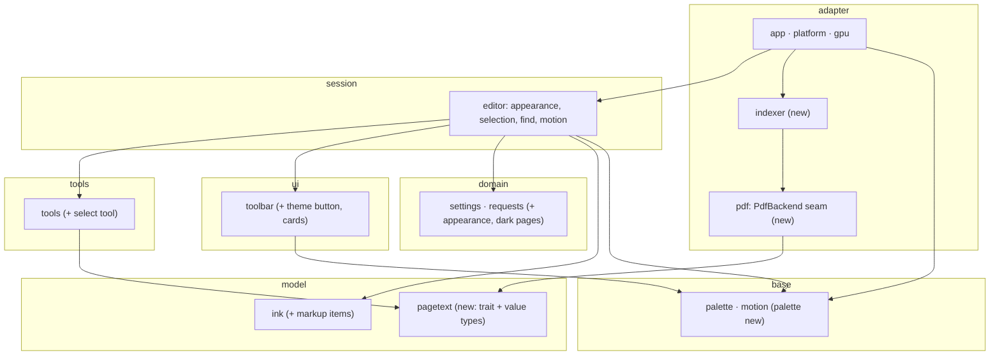

# InkPDF roadmap and handoff

This file is written so that a fresh Claude session (for example a Claude cloud session that has only a clone of this
repository) can pick the work up without the conversation that produced it. Read sections 1 to 3 first, then take **one
task** from section 6, do it on a branch, and leave the CI result as the proof.

- **Written:** 2026-10-29, at version **1.0.0** (commits `e734263` "v1.0.0: the interface moves" and `c4e8a6a` "Demo GIF for 1.0.0"); **re-planned the same day** after Linux and Android landed on `main` (unreleased) and the owner chose the order in section 6.
- **Owner:** Rajat Mandal (`rajatmo`). The owner reviews and pushes; do not push to `main`, open pull requests instead (unless the task says so).
- **Status:** nothing in the milestones of section 6 has been started; the platform work they build on is on `main` (`docs/PORTING.md`). Every task below is a plan, not a record.

## 1. What InkPDF is, and the rules that do not bend

InkPDF is a fast, **pen-first PDF annotator** for **Windows, Linux and Android** (Rust, wgpu on DirectX 12 or Vulkan, a fork of winit;
Windows reads the pen from Win32 pointer messages, Android from `MotionEvent`s, Linux from winit for now: `docs/PORTING.md`). It
reads, renders and writes PDFs with the `pdfcraft-*` crates, pinned to one commit. **Every feature in this plan is built for all three
platforms together**: nothing is Windows-only unless its task says why.

Non-negotiables, agreed with the owner:

1. **The input promise.** With a tool selected, in either mode, every item the tool made can be created, selected, moved,
   restyled, duplicated, copied, pasted, erased and deleted using **only the devices that mode guarantees**: desktop = the
   left mouse button and the keyboard; tablet = the stylus tip. The barrel button, eraser end and right/middle buttons are
   shortcuts, never the only way. Fingers only scroll and zoom. Every new feature goes into the capability matrix
   (`apps/inkpdf/src/editor/tests/capability.rs`).
2. **Latency.** The pen path must not get slower: median about 2.5 ms and 95th percentile about 4.3 ms from pen sample to
   frame submitted on Windows (`--stats` prints it; the editor itself costs under 1 µs per pen move, `editor/tests/latency_budget.rs`).
   No interface animation or other work may run in the pen-down path, and no thread, channel or lock may sit between a pen reader
   and the editor.
3. **An idle window costs no CPU** (frames are requested only while something moves) and the app does not leak (memory,
   handles and threads flat over a 30-round soak, see section 7).
4. **Saved files are standard PDFs.** Ink and shapes are Ink annotations, typed text is Free Text; only annotations whose
   `/NM` starts with `inkpdf-` are loaded back as editable items, everything else stays in the file and is drawn by the
   renderer. A display setting must never change saved data.
5. **Plan first on big changes** and keep real-input tests lean: prefer unit, contract and storm tests.
6. **Layering is enforced by a test** (`apps/inkpdf/src/architecture.rs`): each module has a layer, may use its own layer and
   the ones below, and no two modules may reach each other. When you add a module, add it to the `LAYERS` table there (and
   bump its array length), and to the table in `apps/inkpdf/ARCHITECTURE.md`. `KNOWN_EXCEPTIONS` is empty and stays empty.

## 2. Working in a cloud session (read this before you start)

- **The crate builds on Windows, Linux and Android.** The Win32 code is `platform/windows/` and is compiled only on Windows; on a
  Linux sandbox `cargo test -p inkpdf --lib` and `cargo clippy -p inkpdf --all-targets -- -D warnings` run the whole test suite, and
  Windows and Android can be cross-checked from there (`--target x86_64-pc-windows-msvc`, and `cargo clippy -p inkpdf-android --target
  aarch64-linux-android`). The arbiter is the **GitHub Actions** workflow `.github/workflows/ci.yml`: `check` on `windows-latest`
  (`cargo fmt --all -- --check`, `cargo clippy --all-targets -- -D warnings`, `cargo test`, a release build), then `linux` (with a
  real-window smoke test on a virtual display), `android` (and an emulator run) and the portable builds.
- Therefore: work on a branch, keep each change small, run `cargo fmt` locally if the toolchain is there, push the branch, open a pull
  request (CI runs on pull requests), read the result (`gh run view --log-failed`) and fix until green. Do not guess at a compile; read
  the neighbouring code and copy its idioms. Read `docs/PORTING.md` before touching `platform/` or anything per-OS.
- **Things only the owner can do** (a real Windows desktop, an Android tablet with a stylus, a Linux machine with a pen): the real-input checks `tools/e2e/*.ps1` (they take over the
  mouse and keyboard), the soak, the latency and CPU measurements, building the installer, TikZ icon compilation (MiKTeX).
  When a task needs them, say so in the pull request and list exactly what to run (section 7).
- Style: the code is dense with doc comments that say *why*; tests are long sentences
  (`fn a_page_that_moves_slides_from_where_it_was_and_a_new_one_grows_in()`); `rustfmt.toml` is `max_width = 150`,
  `use_small_heuristics = "Max"`. Line endings are LF for Rust, Markdown, TOML and YAML (`.gitattributes`); `.ps1` and `.iss`
  are CRLF.
- Unit tests are in the library crate (the program is `apps/inkpdf/src/lib.rs`; `main.rs` is only its entry point):
  `cargo test -p inkpdf --lib`. Storms scale with `INKPDF_STRESS=10 cargo test --release -p inkpdf --lib -- --include-ignored`.
- Build output and scratch belong **outside** the repository (`.cargo/config.toml` sends the build to `../inkpdf-build`).
- Do not bump the version, rename `CHANGELOG.md` headings or build installers unless the task says so (section 7 lists what a
  release is).
- To begin a session you can say: "Read ROADMAP.md and do task F1" (or any task id below).

## 3. Architecture primer

Layers, lowest first (full table with every module in `apps/inkpdf/ARCHITECTURE.md`):

| Layer | Modules (today) |
|---|---|
| base | `plane`, `motion`, `scene`, `clock`, `geometry`, `colour`, `coords`, `view`, `text` (`font`, `layout`, `raster`), `smooth`, `clipboard` |
| model | `figure`, `ink`, `laser`, `links`, `outline`, `pages`, `page_table` |
| domain | `tool`, `browse`, `input`, `requests`, `workspace`, `selection`, `settings`, `store` |
| ui | `toolbar` (layout, hit-testing, drawing as plain data; `toolbar/overview/*`) |
| tools | `tools` (what a press on the page does, one file per tool) |
| session | `editor` (routes input, owns the chrome, the history and every animation: `editor/motions.rs`) |
| adapter | `app`, `gpu`, `platform` (`windows/`, `linux`, `android/`), `doc`, `path_store`, `pdf_read`, `ink_io`, `tiles`, `thumbnail` |

The workspace has two crates: `apps/inkpdf` (the app) and `apps/inkpdf-thumb` (an Explorer thumbnail COM DLL; it contains
no PDF code and is not affected by anything below).

Key ideas to know before touching code:

- **Pages are one edit value.** Every change to the pages is a `PageEdit` (`pages.rs`) done by `editor/pages.rs`; ink, links,
  outline, selection and the file's page table all follow it. Page numbers are not identities: **pictures, text and indexes
  are keyed by the page of the file that draws a page** (`Doc::render_page(page)`), so moving, copying or deleting pages
  never re-renders anything. Keep that rule for anything new that is cached per page.
- **The interface is data.** `toolbar` builds a `Ui` (panels, lines, images, labels); `app/ink_layer.rs::sync_ui` caches it
  under a `UiStamp` and rebuilds only when something it was built from changes. A moving value must therefore be part of
  the stamp (see how `look` and `bar_in` are).
- **Motion** (`motion.rs`, `editor/motions.rs`, `scene::Xform`, `Ui::mark/apply`): time is an argument; animations are
  tweens held in `Motions`, stepped once per frame by `Editor::step_view`, which returns whether anything still moves (the
  shell requests another frame only then). Drawing code receives plain numbers. `Prefs` (reduced motion) makes every duration
  zero; the tests run reduced by default (`Prefs::default()` is `cfg!(test)`, see task F3).
- **Doc vs editor.** `doc.rs` (adapter) owns the file, the render pool and the page table; `editor` (session) owns what the
  user sees and edits. They talk through `requests.rs` (`Request::PagesEdited` and friends) and `app/files.rs`.

### Target architecture (after milestone 1.2.0)



Dependency inversion is the point: `pagetext` (model) defines a small trait and value types; the `pdf` module (adapter, the
`PdfBackend` seam)
implements it over pdfcraft; tools and the editor use the trait and never see a pdfcraft type.

## 4. Decisions already made (do not reopen without the owner)

| Topic | Decision |
|---|---|
| Order (owner, 2026-10-29) | **1.1.0** = the PDF backend seam (K tasks) *in parallel with* the dark theme (T tasks); **1.2.0** = text select and search (X tasks, built on the seam); **1.3.0** = polish. The platform backlog (L2, L3, A3, A4, `docs/PORTING.md`) runs beside them; the Android file picker and clipboard (A4) come before 1.2.0 ships on Android. The old 1.0.1 "foundations" milestone is gone (F1 became K1, F2 is parked, F3 opens 1.1.0). |
| Platforms | Every feature is built for **Windows, Linux and Android together**. The platform work is not a release of its own for now: it ships inside the next release. |
| PDF backend | **Pure Rust only.** No C or C++ PDF engine (so no pdfium or MuPDF). pdfcraft stays the backend, behind a seam with a conformance corpus (K1 to K3). |
| Own renderer | **Not planned.** If pdfcraft ever blocks something, fix it in `storytold/pdfcraft`; K3 writes down the criteria for reconsidering, from measured numbers. |
| Theme button | One **three-state** button on the right pill cycling **System → Light → Dark** (System is the default and follows Windows). Pressing it also drops a small second toggle button just below it for **dark pages**. |
| Dark pages | Only **active when the effective theme is dark** (Dark, or System while Windows is dark). In light the toggle is shown dim and does nothing, but its stored value is kept. Settings store `appearance` (System/Light/Dark) and `dark_pages` (bool); effective filter = `dark_pages && scheme == Dark`. It is display only: saved files and stored ink colours never change. |
| How dark pages render | With pdfcraft's **reading colours** (`RenderConfig.reading_colors`, text and background remapped while rendering, images untouched), not a GPU invert. Ink and typed text display colours go through the same mapping so black ink stays visible. |
| System theme | Via winit's `Window::theme()`, `ThemeChanged` and `set_theme()` (also darkens the title bar). No registry or DWM code. |
| Search | PDF text **plus the user's own typed text boxes**, in a **card overlay** (floating, not modal, does not dim the page): field, case and whole-word options, "3 of 17", previous/next, and a scrollable results list with the text around each hit. |
| Select tool | Behaves like the select tool of most PDF apps: drag over text selects it in reading order; double-click a word, triple-click a line; shift+click extends; Ctrl+A, Ctrl+C; draggable end handles for stylus and touch; an action card on the selection (Copy, Highlight, Underline, Strikeout, Search); the same tool also selects, moves and deletes annotations (marquee on empty space). It gets **its own button** in the middle pill. |
| Markup | Highlight, Underline, Strikeout (and Squiggly) from a selection are written as real PDF annotations through `pdfcraft-annot` (supported, see section 5). |
| pdfcraft insulation | A `pdf` module (the K1 backend seam) is the only one that names `pdfcraft_*` or `hayro*`, enforced by a test. Do **not** adopt `pdfcraft-engine` (it has its own undo stack that would fight ours). |
| Not now | Windows ARM64 (scrapped), OCR, forms, printing, signing, redaction, compare, export. |

## 5. pdfcraft: what we use and what it already gives us

Pinned in the root `Cargo.toml` to rev `1dd2737b47a9c1c9562f0af563053d1bf510e4bf` (all `pdfcraft-*` and the vendored
`hayro*`, `lopdf`, `vello_common` lines must agree; the comment there says how to move). The source is a git checkout, read
it at `~/.cargo/git/checkouts/pdfcraft-*/1dd2737/crates/...` after one `cargo fetch`, or on GitHub: `storytold/pdfcraft`.
pdfcraft is **pre-1.0 and moving fast**, which is why the seam (K1) and the conformance corpus (K2) exist. It is a whole suite (cos, annot, render, organize,
create, ocr, forms, edit, redact, sign, compare, print, export, a11y, measure, engine).

**Used today** (all of it moves behind the seam in task K1; the model and base layers no longer name it since S2, and `pdf_read.rs` already reads links, outline and page geometry): `pdfcraft_cos` (`Document`, `Dict`, `Object`, `SaveOptions`,
`write_full`, `write_incremental`, `pdf_date`), `pdfcraft_annot` (`add_annotation`, `delete_annotation`, `NewAnnotation`,
`Meta`, `Shape`, `Style`, `page_refs`, `summaries`, `appearance::parse_da`), `pdfcraft_render` (`RenderPool`, `RenderRequest`,
`RenderConfig`, `RenderedPage`, `PageRenderer`, `Tile`, `inspect`, `device_pixels`, `effective_scale`, `PageInfo`),
`pdfcraft_organize` (`delete_pages`, `duplicate_pages`, `insert_blank_page`, `move_pages`, `page_count`, `bookmarks`),
`pdfcraft_create::blank`. Call sites today (production code, about 20): `doc.rs`, `ink_io.rs` (most), `tiles.rs`, `thumbnail.rs`, `pdf_read.rs`.

**Already there for the roadmap** (so do not write your own):

- **Page text** (`crates/render/src/text.rs`): `PageRenderer::filtered_text(page, TextFilter::default()) -> Result<PageText, String>`
  (also `RenderedPage.text`). `PageText { glyphs: Vec<TextGlyph{text, rect, quad, direction}>, line_of, space_before }` in **page
  view space** (points, origin top-left of the displayed page, rotation applied, y down). Methods: `nearest(x, y) -> Option<usize>`,
  `word_at(i) -> Option<(usize, usize)>`, `line_at(i)`, `line_rects(range) -> Vec<[f32; 4]>`, `glyph_rects(&[usize])`,
  `glyphs_in(rect) -> Vec<usize>` (marquee), `column_text(&[usize]) -> String` (reading order), `text_of(range)`,
  `plain_text()`, `find_opts_limited(needle, case_sensitive, whole_words, limit) -> Vec<Range<usize>>`, and `fold_case(&str)`
  (handles dotted/dotless i and Greek sigmas). Selection in reading order across columns, RTL and CJK is claimed by pdfcraft.
- **Markup annotations** (`crates/annot/src/types.rs`, `create.rs`): `Shape::TextMarkup { kind: Markup, quads: Vec<[f64; 8]> }` with
  `Markup::{Highlight, Underline, StrikeOut, Squiggly}`; quad order is top-left, top-right, bottom-left, bottom-right (what
  Acrobat writes); `Style { color: Rgb, opacity, width, fill }`; `add_annotation(doc, NewAnnotation{ page, shape, style, contents,
  author }, &Meta)`; appearance streams are generated; `delete_annotation`, `set_style`, `set_points`, `summaries`.
- **Reading colours** (`crates/render/src/reading.rs`): `ReadingColors { params: Option<ReadingParams{ text: [u8;3], background:
  [u8;3], only_black, line_art }> }`, set on `RenderConfig.reading_colors` (public field, `crates/render/src/raster.rs`). Display
  only. Print previews ignore it.
- **Also available later, not planned:** `pdfcraft-ocr` (ocrs engine, Latin only, models fetched by `cargo xtask models`,
  CC-BY-SA, writes an invisible text layer into the file, so it would be opt-in), `pdfcraft-forms` (AcroForm filling),
  `pdfcraft-print` (page layout for printing), redaction, signatures, comparison, Word/HTML export, accessibility checks.

## 6. Milestones and tasks

Task ids are stable handles. Each task lists the goal, where to work, how to know it is done, and the tests to add. The order was
chosen with the owner on 2026-10-29:

```
 1.1.0   K (the PDF seam)  ──┐                      K and T run in parallel: T1 to T5 need nothing from K, T6 (dark pages) needs K1
         T (dark theme)    ──┴─►  release 1.1.0
 1.2.0   X (text select and search, on the seam)  ──►  release 1.2.0         (X4 and X5 need A4's clipboard on Android first)
 1.3.0   P (polish)                                ──►  release 1.3.0
 beside  L2, L3, A3, A4 (docs/PORTING.md)          ──►  any time; no release of their own
```

Rules for all of them: all three platforms together; pure Rust only; no behaviour change in a refactor task (tests and storms pass
unchanged); the latency numbers in section 1 do not move; Windows, Linux and Android are each checked (section 7).

### Milestone 1.1.0, part 1: the PDF backend seam (K) and the opening tidy

**F3. Explicit `Prefs` (reduced motion) instead of `cfg!(test)`.** *(about 20 minutes; do it first.)*
*Goal:* production code no longer contains a `Prefs::default()` that depends on `cfg!(test)` (`motion.rs`).
*Work:* the preference is already explicit in the shell (`Platform::motion_prefs()` read at start and on focus, `INKPDF_MOTION=off|on`
overrides it). Make `Prefs::default()` full motion; keep tests reduced through the test helper (`editor()` in `editor/tests/mod.rs`,
and the direct `Editor::new` calls in `stress.rs` and `ink_io.rs` tests), e.g. `Editor::with_prefs` or a `#[cfg(test)]` constructor.
*Done when:* tests unchanged and green; `rg 'cfg!\(test\)' apps/inkpdf/src` finds nothing in `motion.rs`.

**K1. The `pdf` module: a `PdfBackend` seam designed for rendering, text, markup and reading colours.** *(Done 2026-10-29 on branch `pdf-seam`: the trait, the pdfcraft implementation, `doc`, `ink_io`, `tiles`, `thumbnail` and `pdf_read` moved, the enforcement test. Left for later tasks: the page look for dark pages (T6) and markup (X3) are not in the trait yet; text is, as `PageTextView`.)*
*Goal:* `apps/inkpdf/src/pdf/` (adapter layer) is the only module that names `pdfcraft_*` (or `hayro*`); everything else sees the
program's own types and the trait. It replaces the old F1 (its leak-closing step was done by S2: `links`, `outline` and `coords` are pure
and `pdf_read.rs` reads their data).
*Work:*
1. Design the trait from what **three consumers** need, not from what exists today: rendering (tiles, previews, thumbnails, page sizes,
   a *page look* for dark pages: `Normal` or `Reading { text, background, only_black, line_art }`, chosen by the theme and unknown to the backend),
   text (page text in page view space, nearest glyph, word, line, rectangles of a range, marquee, find with options and a limit),
   and the file (open, blank, save full and incremental, page organize: delete, duplicate, insert, move; outline and links as raw
   data; add, delete and list our annotations: ink, shapes, free text, and markup: highlight, underline, strikeout, squiggly). Small
   structs of our own (page geometry, raw outline entries, link targets, save mode); no pdfcraft type in any signature.
2. Move the call sites behind it: `doc.rs` (renderer pool, bytes), `ink_io.rs`, `tiles.rs`, `thumbnail.rs`, `pdf_read.rs` (which
   becomes part of `pdf`). `doc.rs` keeps the pool, the saved bytes and the `FileStore`; `page_table` stays as it is.
3. One pdfcraft implementation, `pdf/pdfcraft.rs`; the trait is object-safe so a test double can stand in (an in-test fake is part of K2).
4. Register `pdf` in `LAYERS` (adapter) and `ARCHITECTURE.md`; tighten `architecture.rs`: `pdfcraft_` and `hayro` may appear only under
   `pdf/` (today the rule is "not below the adapters"); the new test fails on a stray `use pdfcraft_...` anywhere else.
*Done when:* all existing tests and storms pass unchanged; the editor cost per pen move (`latency_budget`) is unchanged; the new test
passes and fails when you add a stray use.
*Do not:* change behaviour, file formats or the pinned rev; add a C or C++ dependency; adopt `pdfcraft-engine`.

**K2. The conformance corpus: what any backend must do.**
*Goal:* switching pdfcraft's commit, or one day another pure-Rust engine, is verified by running one suite.
*Work:* `apps/inkpdf/tests/corpus/` (small files only, generated by `inkpdf-gen` or hand-made and public-domain; a README says where each
came from) with a checked-in expectations file per PDF: page count and sizes (rotated and cropped pages too), the extracted text of each
page (including a two-column page, a right-to-left line and ligatures), find results for given needles, outline entries, link targets,
an annotation round trip (add, save, reopen, delete) and hostile files (truncated, bad xref, huge counts) that must be refused or open
without a panic. Rendering is checked by a tolerance diff against small checked-in PNGs (a tolerance and a tool to regenerate them with
a diff report, `tools/corpus/`). Write it as a generic `backend_contract(make: &dyn Fn() -> Box<dyn PdfBackend>)` like
`platform/contract.rs`'s `source_contract`, run today on the pdfcraft implementation and on an in-test fake for the pure parts.
*Done when:* the suite runs in `cargo test -p inkpdf --lib` on Linux, finishes in seconds, and fails when you change an expectation or
break the pdfcraft implementation on purpose. (CI runs it on all three jobs; the render tolerance is set so the Windows and Linux
rasterisers agree.)

**K3. The upgrade rule, the numbers, and the decision record.**
*Work:* (1) `tools/pdfcraft/bump.sh REV` changes every `rev` line and the `PDFCRAFT_REV` comment together (they must agree), runs the
corpus and prints what changed; the rule, written in `docs/PDF-BACKEND.md`: bump only with the corpus green, in its own commit.
(2) Measure and record, per platform where you can: time to render a tile, a preview and a thumbnail, extraction time per page, memory,
and pdfcraft's share of the binary (`cargo bloat`, `cargo tree`). (3) The decision record: what we depend on, the risks (pre-1.0,
a single maintainer, the vendored `hayro` patches), the options considered (stay; vendor the source into this repository; a second
pure-Rust backend behind the seam; an own renderer, and why it is not planned: fonts, CMaps, JBIG2, transparency and shadings are
the long tail of a spec of about 1000 pages) and the **criteria for reconsidering** (an unfixable fidelity bug, speed on large files,
the project being abandoned, binary size on Android), each with the number that would trigger it.
*Done when:* `docs/PDF-BACKEND.md` exists with the numbers; the bump script is run once on the current rev and reports no change.

### Milestone 1.1.0, part 2: theme (T), parallel to K

**T1. Capture a golden snapshot of today's colours *before* changing anything.**
Add a test (e.g. `toolbar/tests` or a new `theme_golden` test module) that draws every `Ui` producer with fixed inputs
(toolbar for several states, context bar, tool panel with the colour editor, prompt, overview with edit mode, menu, drag) and
compares a stable hash or text dump of the panels/lines/labels against a checked-in golden file (it is plain data, so it runs the same on Linux, Windows and Android). Commit this first; it is
the proof that the refactor changes nothing for the light theme.

**T2. `palette` (base layer).**
*Goal:* all colours come from named roles; today's values are the light scheme.
*Work:* new `palette.rs`: `Scheme { Light, Dark }`, `Palette` with roles (surface/panel, panel edge, shadow, scrim, paper,
ink, dim ink, accent, accent wash, hover wash, pressed wash, separator, track, rim, danger, danger wash, neutral wash, window
background, selection, plus the page roles used by dark pages), `Palette::of(Scheme)`, `Palette::mix(a, b, t)`. Replace the
module constants and literals: `toolbar/theme.rs` (10), `toolbar/prompt.rs` (4), `toolbar/overview/draw.rs` (4), `toolbar/tool_panel.rs`,
`toolbar/context_bar.rs`, `toolbar/mod.rs`, `tools/paint.rs`, `tools/shape/{draft,anchors}.rs`, `app/frame.rs` (`BACKGROUND`),
`app/ink_layer.rs` (`ACCENT`), `gpu/mod.rs`, `thumbnail.rs`. Find the literals with
`rg "\[255, 255, 255, 255\]|\[20, 24, 40|\[16, 20, 44"`. Drawing functions take `&Palette` (put it next to `Look` in the
things the editor hands to `toolbar`); it must be part of the `UiStamp`.
*Done when:* T1's golden test passes with `Palette::of(Light)` (identical output), and a new source-reading test (in the style of
`architecture.rs`) fails if a colour literal reappears in `toolbar/`.

**T3. The dark scheme and its checks.**
*Work:* fill `Palette::of(Dark)` (surface about `#1e2128`-ish, ink light, accent lifted for contrast, shadows weaker, window
background dark, scrim as before). Page paper stays white (dark pages is separate).
*Tests:* contrast ratios (WCAG relative luminance) for ink on panel, dim ink on panel (>= 3), accent on panel, white on accent,
danger on panel, in **both** schemes; a test that every role is defined and `mix` is monotone and exact at its ends.

**T4. Appearance in settings and in the editor.**
*Work:* `settings.rs` gets `appearance: Appearance { System, Light, Dark }` (define the enum in `settings`, not in `palette`) and
`dark_pages: bool`, serialised in `to_text`/`parse` with the existing key=value style; **old settings files must still load**
(there are tests like `settings_from_before_the_shape_tool_still_read`: copy that pattern). The editor resolves
`scheme = appearance.resolve(system_scheme)` and `dark_pages_active = dark_pages && scheme == Dark`; `system_scheme` comes from the platform: add `Platform::color_scheme() -> Option<Scheme>` (the shell also listens to winit's
`WindowEvent::ThemeChanged` in `app/mod.rs`, which already matches on `WindowEvent`). Windows: winit's `Window::theme()` at start and on
change (the shell also calls `window.set_theme(Some(...))` so the title bar follows). Linux: whatever winit reports from the desktop
(X11 and Wayland differ; **check what it gives** and otherwise read the portal's `color-scheme`). Android: **verify first** whether winit
reports it; if not, `None` (System means Light) until A4's JNI work can read the configuration's night mode. Record the finding in this task. Cross-fade between palettes with
a `Tween` in `Motions` (reduced motion: instant) and include the palette (or its mix amount) in the `UiStamp`.
*Tests:* a table test over appearance (3) × system scheme (2) × dark_pages (2) = 12 cases for the effective scheme and filter;
settings round-trip and old-file test; reduced motion switches at once.

**T5. The theme button and the dark-pages drop-down.**
*Work:* a new `Item::Theme` on the right pill (`RIGHT` array in `toolbar/mod.rs`, bump `BUTTONS`, the tests that count them,
`Look`/`Motions` arrays are sized by `BUTTONS`) cycling the three states on press (every device: it is a normal toolbar press via
`Editor::activate`). Pressing it also shows a small pill under it holding one toggle (`Item::DarkPages`) as a `Presence`/slide
(see how the tool panel and the bar under the tools are drawn in `app/ink_layer.rs::sync_ui`); the drop-down folds on a press
elsewhere or Esc. In a light effective scheme the toggle draws dim and does nothing (like undo with nothing to undo,
`look::enabled`). Icons: auto, sun, moon, dark-page. Icons are TikZ sources in `apps/inkpdf/icons/*.tex` compiled to the
committed `icons/svg/*.svg` (needs MiKTeX, owner only); from a cloud session **write the SVGs by hand in the style of the
existing ones** (`Icon::from_svg` in `toolbar/icons.rs`) and note that the `.tex` sources are missing.
*Tests:* editor tests per device (mouse, stylus tip, finger) for cycling and the drop-down; add rows to the capability matrix;
the toggle is inert in light and keeps its value through a trip through light; the equivalence storm in `stress.rs`
(`stress_motion_changes_how_long_things_take_and_never_where_they_end_up`) gets theme toggles added.

**T6. Dark pages.**
*Work (needs K1):* the `PdfBackend` (K1) takes a page look (off, or reading colours built from the palette's page roles, e.g. text
`#e6e6e6` on background `#121212`, `only_black: false`, `line_art: true`) and sets `RenderConfig.reading_colors`; `doc.rs` builds a
new `RenderPool` when the look changes (the pool is created from `RenderConfig`). Texture keys must tell the looks apart:
`tiles::Key::to_tag` packs `page << 40` (20 bits, bits 40 to 59), bit 61 = thumbnail, bit 62 = preview; **bit 60 is NOT free** (it is pdfcraft's `PRINT_TAG`: a request with it set renders in the document's true colours and ignores the reading colours, and `pdf` asserts it is clear); **bit 63 is free**: use it
for "dark look" so old textures stay on screen until the new ones arrive (no flash). Thumbnails and the overview follow. Ink and
typed-text *display* colours are mapped by a pure function in `palette` using the same rule as `ReadingParams` (near-black →
text colour, light → background, hues kept) at the places that build capsules and text bitmaps (`app/ink_layer.rs`
`stroke_capsules`, `app/text_layer.rs` `key_of`); the stored colours are untouched.
*Tests:* saved bytes are identical with the look on and off (`ink_io` round trip); black ink maps to a light colour and back to
black when the look goes off; key tags differ by look and round-trip through `from_tag`; a render with reading colours on
differs from off (use a generated PDF, `inkpdf-gen`).

**T7. Docs, GIF, e2e.** README (theme screenshots), CHANGELOG, `ARCHITECTURE.md` (a Palette section), owner re-records
`docs/demo.gif`/`demo.mp4`, owner runs `tools/e2e/run.ps1` in dark mode (add pixel checks: dark toolbar pixel, dark page
background); add the same checks to `tools/e2e/linux-smoke.sh` (a dark pixel under the virtual display) and look at an emulator
screenshot (`tools/android/emulator-test.sh`). **Release 1.1.0.**

### Milestone 1.2.0: text (select, search, markup)

**X1. `pagetext` (model layer): the interface and value types.**
*Work (the text part of K1's trait returns this trait, so the tools never see the `pdf` module):* new `pagetext.rs`: a trait `PageTextView: Send + Sync` with the operations of pdfcraft's `PageText` that we use
(`nearest`, `word_at`, `line_at`, `line_rects`, `glyph_rects`, `glyphs_in`, `column_text`, `text_of`, `find(needle, case,
whole_words, limit)`, `glyph_count`) in **page view space**, plus plain value types: `TextSelection { page, range }`, `Hit { page,
range }`, a `snippet(view, hit, context_chars)` helper. Add a small in-test fake (a `Vec`-backed implementation) for tests.
Register in `LAYERS` (model).
*Done when:* unit tests of the helpers against the fake.

**X2. Text through the seam, and the indexer.**
*Work:* in `pdf` (K1) implement `PageTextView` over `pdfcraft_render::PageText` and a function that extracts one page from the file
bytes (`PageRenderer::new(bytes, config).filtered_text(page, TextFilter::default())`; the renderer is **not** shared with the
render pool, give the indexer its own). New adapter module `indexer`: one low-priority background thread, a priority queue
(current page and the pages on screen first, then outward), results delivered to the shell through a channel polled each frame
like finished tiles (`app/frame.rs::stream_tiles` is the pattern), cancellable when the file is replaced (save/reload). Cache by
**file page** (`Doc::render_page`), so page edits never re-index. Map page view space to document space with the page's
position and rotation (see `coords.rs`; **verify with a rotated page**).
*Tests:* extraction from a generated PDF with known text (extend `apps/inkpdf/src/bin/gen.rs`: a flag that writes known words);
priority order; invalidation; page edits keep the index valid; a corrupted PDF yields no text and no panic (there is a storm for
hostile PDFs, `hostile_pdf` in `stress.rs`).

**X3. Markup items in the ink store and in the file.**
*Work:* `ink` gets a markup item (kind: Highlight, Underline, StrikeOut, Squiggly; quads in document space; colour and opacity)
with undo/redo, selection, move-with-page (`PageEdit` follow like strokes), bounds, erase and delete. `ink_io.rs`/`pdf::annot`
writes it with `Shape::TextMarkup` and reads our own back (NM prefix `inkpdf-`). **Decide with the owner** whether markups made
by other programs become editable too (today foreign annotations are left in the file and drawn by the renderer; keep that
unless told otherwise). Draw markup ourselves as overlays (page renders exclude our annotations): highlight = translucent
filled rectangles per quad, underline/strikeout = lines, squiggly = a zig-zag; colours with `opacity`.
*Tests:* save and reopen round trip in `ink_io` tests; page edits carry markups (storm `follow_pages` style); history.

**X4. The select tool.**
*Work:* `Tool::Select` (see `tool.rs`: `Tool::ALL`, `name`/`from_name`, `makes_items`, the toolbar `MIDDLE` array, `Look`'s
`TOOLS`, settings tool names, `editor/tests/capability.rs`), `tools/select.rs` (one file per tool, copy the layout of an existing
one such as `tools/shape/`). Behaviour: drag from a glyph (`nearest`) to another selects the range in reading order and draws
`line_rects` as the selection; double-click selects a word (`word_at`), triple-click a line (`line_at`); shift+click extends;
Ctrl+A selects the page's text; Ctrl+C copies `column_text` through the existing text clipboard (`clipboard.rs`, `Platform::clipboard`; **in-memory only on Android and Linux
until A4 and L3**, so copying to other apps needs A4's clipboard before 1.2.0 ships on Android); two draggable handles at the ends for
stylus and touch (**the only way to extend a selection on a tablet: on Android the stylus tip is all there is**, and a finger still pans); Esc clears; a drag that starts on empty
space (no glyph) draws a marquee and selects annotations (reuse `selection.rs` and the existing select-intent code in
`editor/select.rs`; there must stay one idea of "selected"); clicking one of our annotations selects it for move/delete.
The **action card** near the selection (Copy, Highlight, Underline, Strikeout, Search) is drawn by `toolbar` as plain data;
Highlight/Underline/Strikeout create an X3 item from `line_rects` quads. The input promise applies: everything works with the
left mouse button and keyboard, or the stylus tip alone; fingers still pan.
*Tests:* editor tests per device, the capability matrix rows, a storm that selects/extends/copies/marks while pages are
edited and undone, selection survives scrolling and zooming (selection is in document space).

**X5. The search card.**
*Work:* `editor/search.rs` and `toolbar` card drawing: Ctrl+F or a magnifier button opens it (a toolbar button in the left
pill; every device), not modal. Field with caret (typing goes through the existing text-input path, and on Android `Platform::set_text_input` raises the soft keyboard; study
`tools/text.rs` (the text tool, `is_typing`), `editor/routing.rs` (`text_edit`, `is_typing`, where keys are routed) and
`Key::Text`), options (case, whole words, saved in `settings`), "3 of 17", previous/next
(Enter, Shift+Enter, F3, buttons), a scrollable results list (reuse the overview's scroll/glide and `Label` drawing, rows
show `snippet`), tap a row to jump. Searching runs over the indexer's pages as they arrive ("indexing 120 of 400") and over the
user's typed text boxes (`ink.strokes()` with `text`). Debounce about 100 ms; hit cap 5,000. Highlights: translucent
rectangles over the page (current hit stronger, palette roles `search_hit`, `search_current`), the view glides to the current
hit (`View::scroll_to...`), the current marker moves with a `Tween`.
*Tests:* unit tests with the fake text view (folding, whole words, ligatures, a match across lines, empty and huge queries,
hostile Unicode); editor tests per device; page edits and undo keep hits correct; a storm of hostile queries and page edits;
a performance check (indexing a generated 200-page PDF, time and memory) owner-run with `--stats`.

**X6. Docs, e2e, release.** README, CHANGELOG, `ARCHITECTURE.md` (Text section), `tools/e2e/text.ps1` (select a known word, copy,
search a known word, count highlight pixels, step through hits) and the same on Linux (`tools/e2e/linux-smoke.sh`, xdotool) and in the
emulator test, owner runs the checks. **Release 1.2.0.**

### Milestone 1.3.0: polish

**P1.** Split the oversized files without changing behaviour: `stress.rs` (about 2,300 lines; one file per storm), `editor/overview.rs`.
**P2.** The motion gaps: exit animation for the bar under the tools (needs a held view like `Presence<PanelView>`), thumbnail
fade-in when a picture arrives (per-key tween in `app/overview.rs`), the overview's CPU while scrolling with the wheel (measured 2.5%
of a core; look at rebuilding the whole `Ui` each frame during a glide).
**P3.** Overview extras: bookmark flags per thumbnail (writes an outline entry; needs the seam's outline writer) and the
"All pages" filter (title only today).
**P4 (optional, ask first).** Things pdfcraft already makes cheap: a "Make searchable" OCR option (opt-in, models and licence notice),
filling form fields, printing. Only on the owner's say-so.
**Release 1.3.0.**

### Beside the milestones: the platform backlog (`docs/PORTING.md` has the detail)

Not a release of its own; ship each step inside the next release. In this order of value:

- **A4. Android files and clipboard.** The Storage Access Framework (open and save through `content://` addresses: the `FileStore`
  port and `DocId::Uri` exist for it), the system clipboard, opening links. Needs JNI. **Without this, Android cannot open your own
  PDFs; do it before 1.2.0 ships on Android.**
- **A3. Android UI fit.** Touch targets (the bars are sized for a mouse and a pen), system bars and cutouts, the soft keyboard for the
  text tool.
- **L2. Linux pen.** A native reader over Wayland's `zwp_tablet_v2` (and XInput2 on X11): pressure, eraser, barrel, history.
- **L3. Linux polish.** Clipboard, an in-app error card, the animations setting, packaging (AppImage or Flatpak).
- **Measure.** Latency on Linux and Android with `--stats` on real hardware, before any number is claimed.

## 7. Definition of done, checks, and a release

A task is done when:

1. CI is green (fmt, clippy with `-D warnings`, tests, release build).
2. New behaviour has unit or editor tests; input features have capability-matrix rows; anything that moves has a test with
   motion on (`Prefs::FULL`, see `editor/tests/motions.rs`) and the equivalence storm still holds.
3. `ARCHITECTURE.md` and `CHANGELOG.md` say what changed (a new module is in both the doc table and `LAYERS`).

Owner-run checks per milestone (say which ones in the pull request):

| Check | How |
|---|---|
| All tests and storms at 10x | `INKPDF_STRESS=10 cargo test --release -p inkpdf --lib -- --include-ignored` (about 40 s) |
| Real-input checks | `tools/e2e/run.ps1` in the foreground on a quiet machine (smoke, modes, overview, thumbs; add one script per milestone) |
| Latency and idle CPU | `tools/e2e/latency.ps1` and the numbers in section 1; idle window 0% (Windows; Linux and Android: `--stats` on hardware) |
| Linux and Android | `tools/e2e/linux-smoke.sh` (virtual display), the CI `android` and `android-emulator` jobs, and a try on a real tablet with a stylus (`adb logcat -s inkpdf` if it misbehaves) |
| Soak | open and close the overview, add/delete/undo pages and draw for 30 rounds; memory, handles and threads must be flat after the texture cache fills (budget 768 MB) |
| Release | bump `apps/inkpdf/Cargo.toml`, rename the CHANGELOG heading, `apps/inkpdf/installer/build.ps1` and `build-portable.ps1` (Windows), `tools/linux/build-portable.sh` (Linux), `tools/android/build-apk.sh` (Android; the CI jobs build all of them as artifacts), re-record the GIF if the look changed |

## 8. Open questions for the owner (ask, do not assume)

- Should markups made by other programs become editable items (X3)? Default: no, leave them to the renderer.
- Dark-page colours: pure white-on-black reading colours, or the softer pair suggested in T6?
- Where does the magnifier button go (left pill next to the pages button is the default)?
- Is a "Make searchable" OCR option wanted at all (P4), given the model download and licence?
- Android: is `app.inkpdf.test` (the test application id and debug key) to become a real one, and is the Play Store a goal? (It decides signing, the minimum Android version and A4's permissions.)
- Linux: AppImage, Flatpak or only the tarball (L3)?

## 9. Parked or scrapped

**F1 and F2 (old foundations).** F1, the `pdf` façade, became K1 (its leak-closing part was done by S2). F2, `--dump-layout` for the PowerShell
e2e scripts, is parked: it only helps scripts that hard-code positions for a maximised 4K window, and `--record`/`--replay` cover
reproducing a session. Do it only if `tools/e2e/run.ps1` keeps breaking on other screen sizes.

**An own PDF renderer and a second PDF engine.** Not planned (owner, 2026-10-29): pure Rust only, so no pdfium or MuPDF, and writing a
renderer is years of long-tail work (fonts, CMaps, JBIG2, transparency, shadings). K3 records the criteria for reconsidering it.

Windows ARM64 (cross-compile, installers, CI on `windows-11-arm`) was planned and then scrapped for now; the facts gathered:
only the x86_64 target is installed on the owner's machine, no C-compiler crates are in the Windows dependency tree, the
installer today is `ArchitecturesAllowed=x64compatible` (so ARM Windows already runs it emulated), and there is no ARM hardware
to test pen and touch on. Do not start it unless asked.
