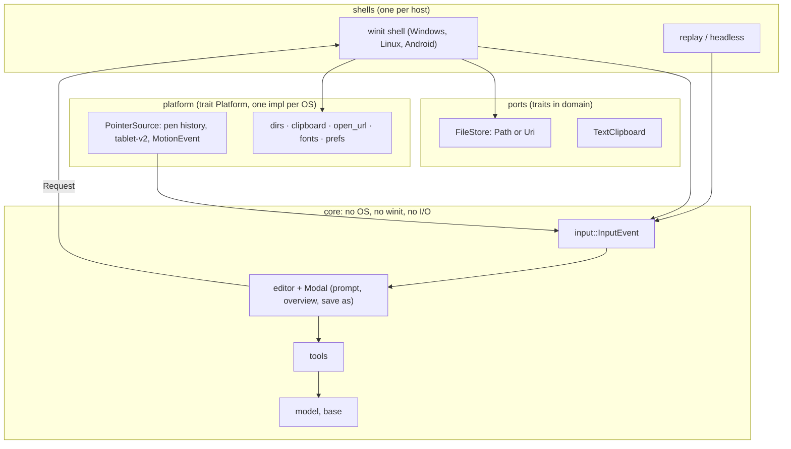

# Architecture review: SOLID, platform independence, latency

Written 2026-10-29 on `linux-android-port`, from the code as it is (numbers are measured or counted, not estimated).

**Status (2026-10-29): R1 to R7 and R9 are done; R8 is done for allocation (the sample-array part waits for hardware numbers).** Each item below says what landed. The text of each plan is kept as it was written.

**TL;DR**

1. The core is already well layered (tested, no upward edges, `Tool` has a contract suite, `Request` inverts the shell).
   It is **not** SOLID in five specific places; each is cheap to fix and none touches the pen path.
2. The editor costs **0.8 µs per batch of pen moves** (release, p99 2.3 µs) against a frame of 8.3 ms at 120 Hz.
   Abstraction in the editor is free; what costs latency is *where the OS queue is read*, *thread hand-offs* and
   *allocator jitter*. So refactor the inside freely; protect the three rules in §3.
3. Highest value for "new features are platform independent": **R1** one input vocabulary (no `winit` in the editor),
   **R2** one modal slot instead of 26 gates, **R3** platform as an object, **R4** storage port (Android needs it).

## 1. Keep (already right)

| Strength | Where |
|---|---|
| Layers enforced by a test, no cycles, none upward | `architecture.rs`, `docs/deps/skeleton.svg` |
| Strategy + contract tests for tools | `tools::Tool`, `editor/tests/contract.rs` |
| The editor asks, the shell answers (Dependency Inversion) | `requests.rs`, `app/files.rs::service` |
| Ports and adapters at the pen: one trait, one event type | `platform::PointerSource`, `input::PointerEvent` |
| Pure, tested rules (geometry, pages, name rules, layout) | `plane`, `pages`, `browse`, `toolbar/*` |
| Time as an argument, not a global | `motion.rs`, `Editor::set_clock` |

## 2. Findings, by principle

| | Evidence | Verdict |
|---|---|---|
| **S** single responsibility | `app::State` has **32** fields (window, GPU, document, frame timing, dialog continuations, text layer, bench); `Editor` 19; `Workspace` 22. `overview::Shown` is now the text layer of *every* modal. `Doc` reads files, owns the render pool, the page table, links and outline. | Mixed: tools and domain are good; the shell and `Doc` do too much. |
| **O** open/closed | A new modal edits **26** places (`chrome.prompt/overview/save_as.is_some()` in `dispatch`, `mouse`, `routing`, `touch`, `overview`). A new OS service edits three OS files and the free-function list in `platform/mod.rs`. A new tool is one file (good). | Tools: open. Modals and OS services: closed to extension, open to edits. |
| **L** Liskov | `Tool` impls share a contract suite (good). `PointerSource` has no contract suite yet; Windows timestamps are QPC, a Wayland source gets wire milliseconds. | Fine today; **add the suite before L2/A2**. |
| **I** interface segregation | `Tool` has **17** methods (6 required) mixing pointer, undo, panel actions and painting. `Editor` derefs to `Workspace`, so the shell can read all of it. `platform::error_box(&Arc<winit::Window>)` hands a whole window to something that needs a handle. | Mild. |
| **D** dependency inversion | **Inner layers do I/O:** `settings` (domain) reads files, env and the exe path (13 sites); `text` (base) scans font folders (4). **`winit` types in the session:** `ElementState`, `MouseButton`, `MouseScrollDelta`, `TouchPhase` (`editor/mouse`, `touch`, `overview`, `save_as`). **`Doc` is path-bound** (`fs::read/write/rename`), so a `content://` file cannot be opened. **`cfg` outside `platform`:** `clock`, `text`, `settings`, `gpu/device`, `doc`. **pdfcraft** named in 7 files, two of them inner layers (`coords`, `links`, `outline`: roadmap task F1). | The real gaps. |

Also a portability risk the review found: **typed text boxes are measured with the system font**, so the same file wraps
differently on a machine whose fallback font is not Arial-metric (Linux without Liberation Sans, Android). See R5.

## 3. Latency: the budget and the three rules

```
L  =  τ_dev + τ_os + τ_wait + τ_editor + τ_scene + τ_gpu + τ_scan
```

Measured here (`editor/tests/latency_budget.rs`, release): `τ_editor` = **1.3 µs** per pen-down, **0.8 µs** per batch of moves
(p99 2.3 µs), **23 µs** at pen-up (it commits the stroke; p99 107 µs). A dynamic call costs about 2 ns, an `Option` check
under 1 ns: even 100 of them per frame are 2.4 × 10⁻⁵ of an 8.3 ms frame. What can move `L`:

| Rule | Why | Guard |
|---|---|---|
| **R-L1 Read late.** The OS queue is read after the display wait (`pump`), nothing between that and the draw but CPU work. | `τ_wait` ≈ 0 is the largest win and the easiest to lose. | frame loop order is the `PointerSource` contract (see `platform/mod.rs`); `--stats` read-age. |
| **R-L2 No hand-offs.** No channel, lock or thread between the pointer source and the editor on the pen path. A reader thread, if one is ever needed, publishes through a lock-free single-producer ring with its own timestamps. | A hand-off adds scheduler latency measured in milliseconds, 1000× the editor's own cost. | contract suite checks `pump` is bounded and allocation-free in steady state. |
| **R-L3 No jitter.** Steady state allocates nothing per sample or per frame. Today Windows allocates at least three `Vec`s per pointer message (history entries, samples, the queue). | Not the p50, but the p99 (11–14 ms swings today are attributed to vblank; do not add to them). | R8; compare `--stats` p99 before and after on hardware. |

The only dynamic calls on the pen path are `PointerSource::pump/drain` (twice a frame) and `Tool::pointer` (once per
event batch). Everything proposed below stays at that count or removes calls.

## 4. Refactors, in order

Each is behaviour-preserving, so the **~660 tests (storms at 10×) are the safety net**; they run on Linux and the
Windows build is cross-checked from Linux with clippy. None touches the pen-down path except R8.

### R1. One input vocabulary: no `winit` in the editor  *(small, low risk)*

*Problem.* The session imports four `winit` types. A shell that is not winit (Android with its own `MotionEvent`
bridge, a headless replayer, an embedding host) cannot drive the editor without winit, and the mouse arrives as separate calls (`mouse_moved`, `mouse_button`, `wheel`)
instead of the same `PointerEvent` as pen and touch.
*Change.* `input` (domain) gets `MouseButton`, `Wheel { Lines(f32, f32) | Pixels(f32, f32) }`, a key event with
modifiers, and a touch phase that is just `Phase`. Mouse becomes `PointerEvent { device: Mouse }` like pen and touch. The shell
translates (it already does for keys). Then `architecture.rs` can forbid `winit` in `editor` and the `ADAPTERS` exception for the session goes away.
*Effect.* Any shell feeds one `Editor::handle(InputEvent)`. A recorded event stream replays identically on every OS
(see R9). *Latency.* None (same data, one fewer enum conversion).

### R2. One modal slot instead of 26 gates  *(medium, low risk; done: `editor/modal.rs`)*

*Done.* `Editor::modal()` says which layer is on top (prompt, then Save As, then overview); every route matches on it. Side effect: a click now reaches the prompt when it is up over Save As (before, Save As got it).

*Problem.* Each modal (prompt, overview, Save As) is checked separately at every entry point.
*Change.* `chrome.modal: Option<Modal>` with `enum Modal { Prompt, Overview, SaveAs }` and one
`Editor::modal_event(&InputEvent) -> bool` at the top of `handle`. Each modal implements the same small trait
(`event`, `key`, `wheel`, `draw`, `presence`). Start with the enum (one place to extend), graduate to `Box<dyn Modal>` only when
something outside the crate needs it. The shell's `sync_*_ui` trio becomes one `modal.draw(&mut Ui)`; rename `overview::Shown` to `UiLayer`.
*Effect.* A new card (error, share, settings) is one file. *Latency.* One discriminant check replaces up to three.

### R3. Platform as an object, not free functions  *(medium, low risk; done)*

*Done.* `platform::Platform` (documents, places, mode, motion prefs, open_url, error box, text input, clipboard, `install_pointer`) is built once by `platform::native()` and held by `State`. The window crosses the seam as `&dyn HasWindowHandle` plus a `Waker`; Windows keeps an `HWND`, not an `Arc<Window>`. `platform::fake::FakePlatform` runs the shell's calls with no OS. Process-level calls before a window exists (`attach_parent_console`, `report_fatal`, Android's `android_app_started`/`welcome_document`) stay free functions.

*Problem.* `platform` re-exports the same names from three modules; nothing but a build on each OS checks they agree, nothing
can be mocked, and Linux cannot choose Wayland or X11 at run time.
*Change.* `trait Platform { fn dirs(&self) -> Dirs; fn clipboard(&self, w: &dyn HasWindowHandle) -> Option<Box<dyn TextClipboard>>; fn open_url(&self, &str); fn motion_prefs(&self) -> Prefs; fn install_pointer(&self, w: &dyn HasWindowHandle) -> Result<Box<dyn PointerSource>, String>; … }`
built once in `main`, held by `State`. Window handles come from `raw-window-handle`, not `winit::Window`.
*Effect.* The shell becomes testable with a fake platform; a new OS or backend is one `impl`; the contract is checked by the compiler.
*Latency.* None: only `PointerSource` is on the pen path and it already is a trait object.

### R4. A storage port, so a file need not be a path  *(medium, medium risk; done)*

*Done.* `store` (domain) has `DocId::{Path, Uri}` and `trait FileStore { read, write_atomic, list }`; `path_store::PathStore` (adapter) holds today's behaviour, moved whole (the temp-and-rename, the read-only refusal, the folder listing with its hidden-file rules and tests). `Doc` keeps an `Option<DocId>` and reads and writes only through a store (`open_from`, `save_to`, `save_as_to`; the path-taking ones remain for tests). `Request::SaveTo` carries a `DocId`; `Platform::file_store()` hands the shell its store, so Android's picker is one `impl`. The Save As dialog still browses by path (an Android picker would replace the dialog, not feed it).

*Problem.* `Doc::open(path)` and `write_to` use `std::fs` directly (including the atomic temp-and-rename and, now, the
read-only check). Android hands out `content://` URIs; sandboxes forbid paths.
*Change.* `trait FileStore { read(&DocId) -> io::Result<Vec<u8>>; write_atomic(&DocId, &[u8]); list(&DocId) -> Vec<Entry> }`,
`DocId::{Path, Uri}`; `Doc` already keeps its bytes (`base: Arc<Vec<u8>>`), so it becomes bytes in, bytes out. `PathStore` keeps today's behaviour and
tests; `Request::SaveTo(DocId)`; the Save As listing goes through the same port. *Effect.* Android's picker and storage are one `impl`. *Risk.* The atomic-save and permission rules must move whole; the existing `doc` tests cover them.

### R5. No I/O in the inner layers; one font everywhere  *(small, low risk; done)*

*Done.* `settings` only parses and prints; `app/config.rs` reads and writes the file in `Platform::config_dir()` (portable mode kept). `text::set_font(bytes)` takes Arial from `Platform::system_font()` on Windows, and every other OS uses the built-in Liberation Sans (`assets/fonts/`, OFL, as wide as Arial). `clock` is `Instant` only; Windows converts its counter stamps in `platform/windows/counter.rs` with an offset measured once. The layering test `nothing_below_the_adapters_touches_the_disk_the_environment_or_an_operating_system` enforces it. Left as they are, on purpose: the GPU backend choice (`gpu/device.rs`, an adapter by nature) and `doc`'s read-only check (moves with R4).

*Problem.* `settings` (domain) and `text` (base) touch the disk and the environment; five modules carry `cfg`.
*Change.* `Settings` keeps its data and `to_text/parse`; `load/save` move to an adapter that asks `platform` for the config
folder. `text::set_font(bytes)` is called at start from `platform::system_font()`, **with a bundled fallback font** (Liberation Sans, OFL) so text
measures the same on every OS and the tests no longer depend on the machine. `clock`, `gpu/device`, `doc` take their per-OS fact from `platform`.
*Effect.* `base` and `domain` become I/O-free and the layering test can say so. Saved text-box geometry no longer varies by machine.

### R6. Split the shell's `State`  *(medium, low risk; done)*

*Done.* `State` keeps the window, GPU, editor and platform, and three plain structs: `FrameLoop` (`timing`), `DocumentSession` (`session`) and `UiLayers` (`layers`). Fields, not objects: nothing is added to the frame path.

*Change.* `FrameLoop` (timing, bench, latency stats), `DocumentSession` (doc, `then`, `save_then`, files), `UiLayers` (the GPU-side
caches and bitmaps), plus window and GPU. Plain structs holding fields, no extra indirection on the frame path.

### R7. A contract suite for `PointerSource`  *(small, do before L2/A2)*

Generic tests any source must pass, driven by a scripted fake: events in order, timestamps monotonic and on the
`clock::now_ms` base, hover/leave pairing, `pump` bounded and allocation-free in steady state, nothing after `uninstall`.
Document the timestamp conversion each OS must do (wire milliseconds to the app clock).

### R8. Hot-path hygiene  *(small; only with hardware numbers; the allocation part done)*

*Done.* `PointerSource::drain_into(&mut Vec<PointerEvent>)` (and `drain_other_into`) replace the `Vec`-returning drains: the shell keeps its two buffers and the source its queue, so a steady stream no longer re-grows a `Vec` every frame (the Windows reader used to `mem::take` its queue, leaving an empty one that grew again). The contract suite checks that it appends and keeps the caller's room. *Not done, waiting for `--stats` numbers from a real pen:* inline sample arrays in `PointerEvent` and reused history buffers in the Windows reader (they touch every consumer of `samples`).

`drain_into(&mut Vec<PointerEvent>)`, reused sample buffers (inline small array), reused history buffers in the Windows reader. It
removes allocator jitter (R-L3), not median latency, so do it last and keep it only if `--stats` p99 improves on a real pen.

### R9. Record and replay  *(small, after R1; done)*

*Done.* `--record FILE` copies every event given to the editor (as `input::record` text, one line each, floats exact to the last bit); `--replay FILE` plays a recording at its old pace and closes half a second after the last event. A headless test plays a session through the text format into a fresh editor and compares the document; `tools/e2e/linux-smoke.sh` records and replays a real run.

`--record FILE` / `--replay FILE` of the closed input vocabulary: the same stream gives the same document on every OS (CPU-side
regression and the latency benchmark without a display), and a bug seen on one machine can be replayed on another.

## 5. Target picture



## 6. Order, and what not to do

1. R7 and R1 first (small, unblock L2 and A2 and make R9 possible), then R2, R3, R5.
2. R4 when Android file access (A4) starts; R6 whenever `State` is next touched; R8 last.
3. Do not add a thread, channel or lock between the pointer source and the editor; do not add per-sample dynamic dispatch;
   do not let a refactor change the order *wait, pump, drain, draw*.
4. Each step lands with its tests unchanged and green, the Windows cross-clippy clean, and (R8 only) `--stats` numbers from hardware.

## References

Parnas, *On the Criteria To Be Used in Decomposing Systems into Modules*, CACM 1972 (information hiding). Meyer, *Object-Oriented
Software Construction*, 1988 (open/closed). Liskov and Wing, *A Behavioral Notion of Subtyping*, TOPLAS 1994. Martin, *Design Principles
and Design Patterns*, 2000, and *Clean Architecture*, 2017 (SOLID; the dependency rule). Cockburn, *Hexagonal Architecture* (ports and
adapters), 2005. Feathers, *Working Effectively with Legacy Code*, 2004 (a test suite as the safety net for refactoring).
Latency: Ng et al., UIST 2012; Annett et al., Graphics Interface 2014 (see `docs/PORTING.md`).
